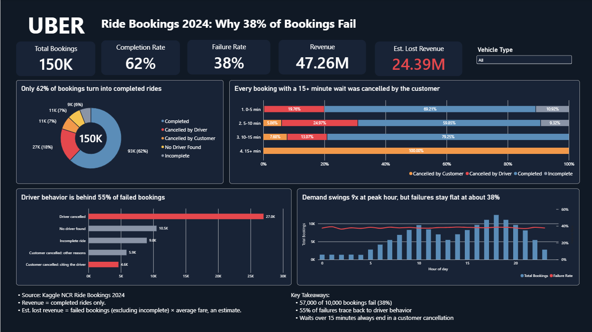

# Why 38% of Uber Ride Bookings Fail

Delhi NCR, 2024 · A MySQL and Power BI case study



## Overview

Only 62% of the 150,000 ride bookings in this dataset end in a completed ride. I wanted to find out why the rest fail and what a business should look at first.

**Tools:** MySQL (cleaning and analysis) · Power BI and DAX (dashboard) ·

## What I found

1. **38% of bookings fail.** That is 57,000 of 150,000: 27,000 cancelled by the driver, 10,500 cancelled by the customer, 10,500 with no driver found and 9,000 incomplete.
2. **Drivers start the most failures.** Driver cancellations make up 47% of all failures. Add the 4,630 customers who cancelled because the driver wasn't moving or asked them to cancel, and driver involvement rises to about 55%.
3. **Long waits always end in a cancellation.** All 3,521 bookings with a 15+ minute wait were cancelled by the customer. Customer cancellations by wait time: 0.1% (0-5 min), 5.9% (5-10), 7.7% (10-15), 100% (15+).
4. **It is not a peak-hour problem.** Demand swings about 9x through the day, yet the failure rate stays between 36% and 39% in every hour. Vehicle type, weekday and month make no real difference either.
5. **About 24.4M is left on the table (estimate).** That is 48,000 cancelled or unfulfilled bookings at the average fare of 508.2, against 47.26M earned from completed rides.


## Dashboard

One page for the charts and another page for Insights and recommendation, built to read top to bottom: the problem, then the causes, then what is not a cause.

- **KPI cards:** total bookings, completion rate, failure rate, revenue, estimated lost revenue
- **Donut:** where all bookings end up
- **Failure causes:** driver cancelled, customer cancelled citing the driver, other customer reasons, no driver found, incomplete
- **Wait time vs outcome:** a 100% stacked bar by wait-time band
- **Hourly demand vs failure rate:** columns for bookings, a row for hour, and a line for the failure rate
- **Vehicle Type slicer:** the pattern holds for every vehicle
- **Key insight:** Contains the findings of dashboard page and suggests actions.


## Data

- **Source:** [Kaggle, NCR Ride Bookings]([https://www.kaggle.com/](https://www.kaggle.com/datasets/yashdevladdha/uber-ride-analytics-dashboard))
- **Size:** 150,000 bookings, 21 columns, 1 Jan to 30 Dec 2024
- **Wait time (`Avg VTAT`):** minutes for the vehicle to reach the pickup point
- **Revenue:** completed rides only. The dataset doesn't state a currency

## How I did it

### 1. Cleaning (MySQL)

I left the raw table `ncr_ride_bookings` untouched and worked in a copy, `uber_rides_staging`.

| Check | What I found | What I did |
|---|---|---|
| Blank Booking IDs | Checked | No blank rows found |
| Fully duplicated rows | None | Nothing to remove |
| Repeated Booking IDs | 1,233 IDs reused across different rides | Kept every row, and didn't use Booking ID as a primary key |
| Data types | Imported as text | Converted dates, times and numbers to proper types |

Many blanks are expected. Cancelled rides have no fare, payment method or rating, so filling those in would be wrong.

### 2. Analysis (MySQL)

All queries are in the attached sql file, these queries used for analysis purpose, no data modification.

- Completion rate, failure rate, revenue and average fare
- Outcome mix, and failure rate by vehicle type
- Bookings and failure rate by hour
- Cancellation reasons by customer and by driver
- Wait-time band vs booking outcome
- Estimated lost revenue

### 3. Dashboard (Power BI)

I added three calculated columns (hour of day, wait-time band, and a failure-cause label that groups the cancellation reasons) and a few measures: total bookings, failure rate, revenue (completed rides only), average fare and estimated lost revenue.

## What I tested and ruled out

I checked the other columns for a link to failures. Only wait time showed one.

| Factor | Result | Clear difference? |
|---|---|---|
| Wait time | Customer cancellations climb from 0.1% to 100% as waits get longer | **Yes** |
| Hour of day | Failure rate is 36-39% in every hour | No |
| Vehicle type | 37.4-38.6% across all seven types | No |
| Day of week and month | Failure rate stays near 38% | No |
| Pickup area | 33.7-45.3% across 176 areas, but with only about 850 bookings each, small gaps aren't reliable | No |
| Ratings | Driver about 4.23 and customer about 4.40 for every vehicle type | No |
| Ride distance | Almost no link to why rides failed | No |

I left "worst pickup areas", "business growth per month", "payment methods", etc. charts out of the dashboard on purpose. These samples weren't necessary for the specified case study.

## Limitations

- **The data looks simulated.** Fares don't depend on distance, and most rates are almost uniform. The project shows the method more than real Uber operations.
- **The lost revenue figure is an estimate.** It assumes every lost booking would have paid the average fare, so treat it as an upper bound.
- **There is no cost, margin or driver-supply data**, so the impact of any recommendation can't be sized properly.


```

---
Author: [Umme Mahbuba Tamanna][https://github.com/Umme-Tamanna] · [LinkedIn](www.linkedin.com/in/umme-mahbuba-tamanna) · [Email][ummemahbuba30@gmail.com]

